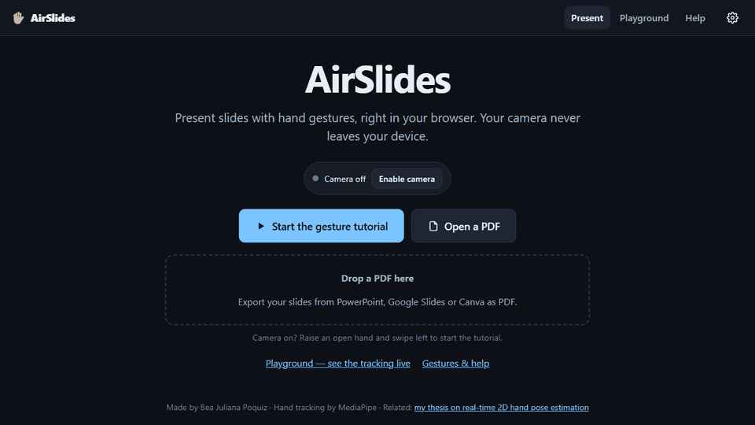
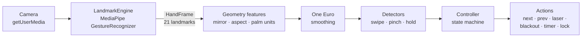

# ✋ AirSlides

**Present slides with hand gestures. Hand tracking runs on your device, right in the browser.**

[](https://github.com/beapoquiz/airslides/actions/workflows/ci.yml)
[](https://github.com/beapoquiz/airslides/actions/workflows/deploy.yml)
[](LICENSE)

### ▶ Live demo: **[beapoquiz.github.io/airslides](https://beapoquiz.github.io/airslides/)**

<!--
  docs/demo.gif is currently a UI tour made from screenshots. Replace it with a
  real ~10 s recording:
    1. Windows: ScreenToGif (https://www.screentogif.com) → "Recorder", ~15 fps.
       macOS: Kap (https://getkap.co).
    2. Open the live site, start the tutorial, make the camera bubble large
       (⚙ → Camera bubble size → Large) so viewers can see the skeleton.
    3. Record: swipe left (next) → pinch and point with the laser → hold a fist
       (lock 🔒) → talk with your hands (nothing happens) → fist again to unlock.
    4. Export at ~960 px wide, keep it under ~5 MB, save as docs/demo.gif.
-->



Open the site, allow the camera, and either take the built-in **gesture tutorial** or open a
**PDF** exported from PowerPoint, Google Slides or Canva. A small camera bubble in the corner
shows the mirrored feed, the tracked hand skeleton and the gesture being recognised, so the
audience can see it working. It runs on laptops, tablets and phones. No backend, no uploads.

## Gestures

| Gesture                           | Action                      |
| --------------------------------- | --------------------------- |
| Swipe **left** with an open hand  | Next slide                  |
| Swipe **right** with an open hand | Previous slide              |
| **Pinch** (thumb tip + index tip) | Laser pointer while pinched |
| **Open palm** held still ~1 s     | Blackout on / off           |
| **Thumbs up** held still ~1 s     | Start / pause talk timer    |
| **Fist** held still ~1 s          | Lock / unlock gestures      |

Holds show a progress ring in the camera bubble and fire about 0.3 s after it fills.

"Left" and "right" are from **your** point of view in the mirrored preview, like flicking a
page on a phone: moving your hand toward your left means next. You can invert this in Settings.

### Keyboard (and presentation clicker) fallback

| Keys                   | Action                    |
| ---------------------- | ------------------------- |
| `→` `PageDown` `Space` | Next slide                |
| `←` `PageUp`           | Previous slide            |
| `Home` / `End`         | First / last slide        |
| `B`                    | Blackout                  |
| `T` / `R`              | Timer start–pause / reset |
| `L`                    | Lock / unlock gestures    |
| `F`                    | Fullscreen                |
| `C`                    | Show / hide camera bubble |
| `?`                    | Shortcut help             |

On touch screens, tap the right side of a slide for next and the left side for previous.
Everything works with the keyboard alone if there is no camera.

## How it works



Each camera frame (`requestVideoFrameCallback`, one inference at a time) goes through a
`LandmarkEngine`, which returns an engine-agnostic `HandFrame`: 21 landmarks in MediaPipe order,
handedness, and an optional "canned" gesture label. Everything after that is plain TypeScript
with no MediaPipe dependency. The `GestureController` only consumes `HandFrame`s, so it is
unit-tested with synthetic hands and would work unchanged with another engine.

**Palm-size normalisation.** Normalised image x and y have different pixel scales, so points are
first aspect-corrected. Every distance and speed is then measured in _palm sizes_ (wrist → middle
knuckle). "Swipe at least 1.5 palms at ≥ 3 palms/s" means the same thing whether you stand 0.5 m
or 1.5 m from the camera.

**Swipe detection.** A 350 ms window of palm-centre positions must show mostly horizontal travel,
far and fast enough, with an open hand (≥ 3 extended fingers). Hands entering the frame are
ignored for 200 ms. It is tuned on captured MediaPipe output, where a fast swipe often looks
like frozen landmarks followed by a single leap, or a brief dropout, with the palm size distorted
by motion blur. A single large horizontal leap therefore counts as a swipe, and palm size and
"open hand" are measured while the hand is still. On a motion-blurred benchmark this raised
detection from 11/33 to 33/33 swipes with zero wrong-way slides (details in
[docs/DECISIONS.md](docs/DECISIONS.md#swipe-responsiveness-pass-october-2026)).

**Return-stroke suppression.** After a swipe your hand naturally swings back. For 1 s the opposite
direction is ignored; a swing-back that starts in that window stays ignored until your hand
settles, and a rejected motion is _consumed_ rather than left in the buffer. Even a swipe that
failed to fire blocks its own swing-back, so the slide never moves the wrong way.

**Hold vs swipe (stationarity).** Palm / thumbs-up / fist actions need the pose held still: the
ring fills in 1 s and the action fires after a further 0.3 s confirmation, while the palm centre
stays within half a palm of where the hold started. An open hand that is moving is therefore a
swipe candidate, never a blackout. The confirmation window matters because MediaPipe briefly
freezes the landmarks when a swipe starts, so a resting hand would otherwise look still just long
enough to black out the screen. After a swipe the palm-hold is latched until you lower your hand.
Short tracking dropouts (< 20 % of the hold) are tolerated. A hold fires once and must be released
before it can fire again.

**Pinch → laser.** Thumb–index distance with hysteresis (enter < 0.35 palm, exit > 0.50, two
frames each) and a guard that the index finger is reaching out, so a closed fist (whose curled
fingertips also touch) never turns the laser on. The pinch point is smoothed with a One Euro
filter and the central 70 % of the camera view is mapped onto the whole slide.

**Lock.** Holding a fist locks gesture control so you can talk with your hands. While locked,
only another fist-hold does anything and the camera bubble dims with a 🔒. During blackout, only
palm-hold (restore) and fist-hold work.

The poses are classified two ways: MediaPipe's canned gesture when it's confident (≥ 0.6), and
rule-based finger geometry otherwise. The rule-based path is what makes the pipeline
engine-agnostic. The **Playground** page shows both side by side, along with FPS, inference time,
a pinch meter, a live speed sparkline, hold progress, the controller state, an event log, and
sliders for every threshold.

## Why MediaPipe (and where my thesis fits)

My [undergraduate thesis](https://github.com/beapoquiz/heterogeneous-kd-2d-hand-pose-estimation)
distils an HRNetV2-W18 teacher into a BlazeHandLandmark student (2.01 M parameters, 139 FPS on
a laptop GPU). That student is only the _landmark_ stage: it needs a hand detector to give it a
crop, it was trained mostly on synthetic RHD data (plus a FreiHAND fine-tune), and it's a PyTorch
model. MediaPipe's GestureRecognizer is a complete, browser-ready detector + landmark pipeline
for every device, so it powers v1. The `LandmarkEngine` interface is built so the thesis model
can be dropped in as a second engine. See [docs/PHASE2.md](docs/PHASE2.md).

## Privacy

Everything runs on your device. Camera frames are processed in the browser and are never uploaded
or stored. PDFs are opened in memory and never leave your device. There are no accounts,
analytics or cookies; settings are kept in your browser's local storage only. The MediaPipe WASM
runtime and model are served from this site itself.

## Run it locally

Requires Node.js ≥ 20 (22 or 24 recommended).

```bash
git clone https://github.com/beapoquiz/airslides.git
cd airslides
npm install
npm run dev          # http://localhost:5173 (downloads the model on first run)
```

`predev` / `prebuild` copy the MediaPipe WASM and pdf.js assets into `public/` and download the
gesture model (`gesture_recognizer.task`, ~8 MB, gitignored) once.

### Test from your phone

The camera needs a secure context, so plain `http://<your-laptop-ip>` won't work on a phone:

```bash
npm run dev:https    # self-signed HTTPS on your LAN (--host)
```

Open the `https://192.168.x.x:5173` URL it prints on a phone on the same Wi-Fi and accept the
certificate warning. Or just use the [live demo](https://beapoquiz.github.io/airslides/).

### Tests and checks

```bash
npm test             # Vitest unit tests (synthetic hands + recorded fixtures)
npm run test:e2e     # Playwright smoke test (Chromium, fake camera, production build)
npm run typecheck
npm run lint
npm run format       # Prettier
npm run build && npm run preview
```

Unit tests build synthetic 21-point hands (open palm, fist, thumbs up, pinch, relaxed) and
replay timed sequences through the controller: swipes near and far, slow drift, vertical motion,
return strokes, hands entering the frame, tracking glitches, dropouts, lock and blackout rules.
You can also record **real** landmark sequences in the Playground and drop them into
[`tests/fixtures/recorded/`](tests/fixtures/recorded/README.md). They are replayed as tests with
label-specific expectations. A hands-on checklist lives in
[docs/MANUAL_TEST.md](docs/MANUAL_TEST.md).

## Project structure

```
src/
  main.ts                 hash router (#/present, #/playground, #/help)
  config.ts               every gesture threshold, documented
  settings.ts             persisted settings (works without localStorage)
  runtime.ts              camera + engine + frame loop + controller, shared by views
  engine/                 LandmarkEngine types, MediaPipe engine, engine registry
  camera/                 getUserMedia wrapper, frame loop
  gestures/               geometry, One Euro, pose, pinch, swipe, hold, controller
  slides/                 Deck interface, interactive tutorial deck, pdf.js deck
  ui/                     present / playground / help views, bubble, HUD, laser, …
  recorder/               HandFrame recorder (fixtures)
tests/                    Vitest: synthetic hand templates, sequence builder, fixtures
e2e/                      Playwright smoke test
scripts/                  fetch-model.mjs, copy-assets.mjs (cross-platform Node)
docs/                     DECISIONS, PHASE2, MANUAL_TEST
```

## Roadmap

- **Phase 2:** the thesis model (BlazeHand-KD) as a second engine via ONNX + onnxruntime-web,
  with an A/B mode in the Playground ([plan](docs/PHASE2.md)).
- A presenter view with speaker notes on a second screen.
- Two-hand gestures (e.g. zoom) and user-defined gesture mappings.
- Offline support (service worker) for presenting without Wi-Fi.
- A calibration step that tunes thresholds to each presenter.

## Related work

[heterogeneous-kd-2d-hand-pose-estimation](https://github.com/beapoquiz/heterogeneous-kd-2d-hand-pose-estimation):
Real-time 2D hand pose estimation via heterogeneous knowledge distillation (HRNetV2-W18 →
BlazeHandLandmark), 4.8× smaller than the teacher and 20× faster (139 FPS on GPU).

## Credits

- [MediaPipe Tasks Vision](https://ai.google.dev/edge/mediapipe/solutions/vision/gesture_recognizer):
  hand landmarks and gesture recognition (Apache-2.0).
- [pdf.js](https://mozilla.github.io/pdf.js/): PDF rendering (Apache-2.0).
- One Euro filter: Casiez, Roussel & Vogel, _1€ Filter_, CHI 2012.
- Hand illustrations are simple shapes drawn for this project.

## License

[MIT](LICENSE) © 2026 Bea Juliana Poquiz
